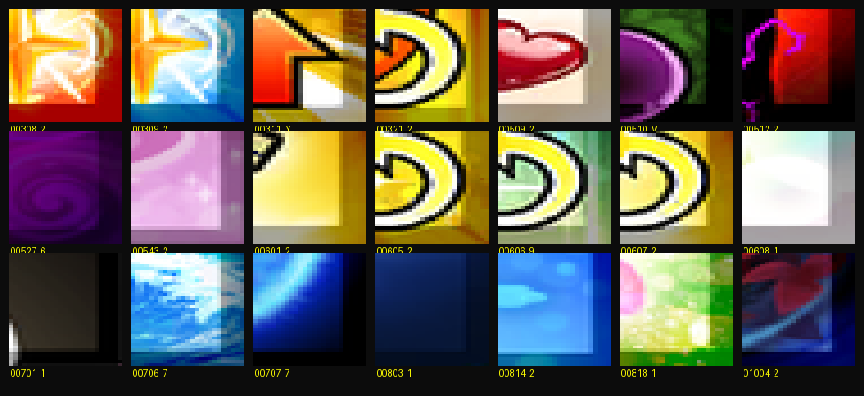
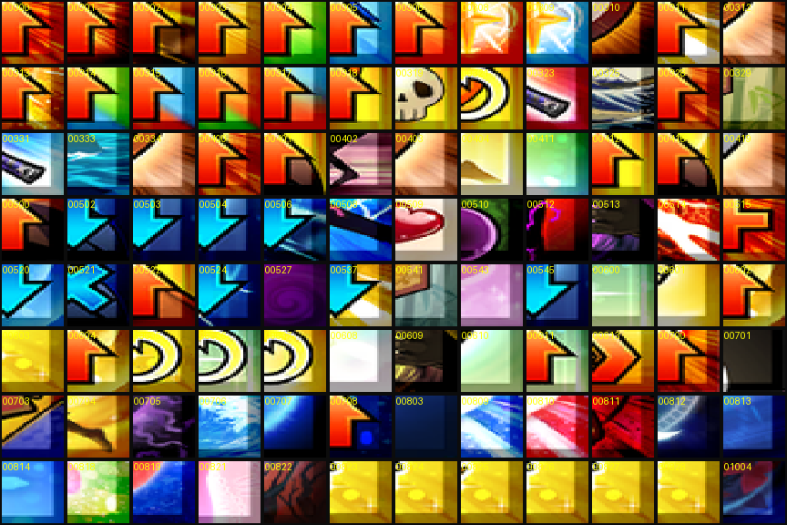

# 技能图标右下角冷却识别扫描报告

## 方法

- 资源：`assets/icons/skill_*.png`，共 **96** 个技能图标。
- 参数：当前自动战斗使用的右下角裁剪 `dx=0.012, dy=0.009, w=0.015, h=0.040`（相对技能按钮中心），纯识别 `recognize_strips`，整段文本为纯数字才算冷却。
- 处理：图标统一缩放到 96×96（等同游戏内按钮的图标区域），合成 48×48 角落拼图后一次 OCR；同一参数再在真实帧 `battle_scene_cn.png`（就绪）与 `bug1.png`（冷却）上复核。

## 结果摘要

- **21/96** 个图标的右下角在至少一次运行中被识别成**纯数字** → 存在把就绪技能误判为冷却的风险。
- 其余图标大多被识别成 `M/Y/P/L/V/J/D` 等字母或中文（来自图标里的目标箭头），纯数字规则会过滤，安全。
- 即使同一图标，两次 OCR 结果也可能不同（箭头形状接近数字），因此误判是概率性的。

## 高风险图标（至少一次纯数字）

| 图标 | OCR 文本 | 结论 | 对应从者 / 技能（部分） |
| --- | --- | --- | --- |
| skill_00308 | 2 | 纯数字 | 永仓新八 / 剑伐怒顶 C；阿周那〔Alter〕 / 千里眼（超越） EX |
| skill_00309 | 2 | 纯数字 | 忒修斯 / 直觉（迷宫） B++；女教皇若安 / 幻想圣人 A |
| skill_00311 | Y / 7 | 纯数字 | 克莱恩小姐 / 千年的报恩 A；安妮·伯妮＆玛莉·瑞德 / 配合 C |
| skill_00321 | 2 | 纯数字 | （未找到从者技能映射） |
| skill_00509 | 2 | 纯数字 | 幼吉尔 / 红颜美少年 C；幼吉尔 / 贤王的萌芽 B |
| skill_00510 | V / 5 | 纯数字 | 喀耳刻 / 毒之食馔 A；洛库斯塔 / 毒药调配 A+ |
| skill_00512 | 2 | 纯数字 | 太岁星君 / 凶神 A；太公望 / 封神执行 B |
| skill_00527 | 6 | 纯数字 | 玛丽·安托瓦内特〔Alter〕 / 嘲讽的断头台 B；宇津见绘里濑 / 黄泉路的边界 C |
| skill_00543 | 2 | 纯数字 | 阿比盖尔·威廉姆斯〔夏〕 / 蔷薇的沉睡 B |
| skill_00601 | 2 | 纯数字 | 玛尔达 / 水边圣女 B+；克莱恩小姐 / 一夜羽织 B |
| skill_00605 | 2 | 纯数字 | 伊丽莎白·巴托里〔万圣节〕 / 无辜的怪物 EX；伊丽莎白·巴托里〔万圣节〕 / 万圣节之星 EX |
| skill_00606 | 9 / 2 | 纯数字 | 斯巴达克斯 / 受虐的荣誉 B；斯巴达克斯 / 受虐的荣誉 B+ |
| skill_00607 | 2 | 纯数字 | 阿比盖尔·威廉姆斯 / 信仰的祈祷 C；阿比盖尔·威廉姆斯 / 于深渊化作光 A |
| skill_00608 | 1 | 纯数字 | 血斧埃里克 / 嗜血兽斧 A+；BB / 十之王冠 D |
| skill_00701 | 1 | 纯数字 | 骑士迪昂 / 秀丽风情 C |
| skill_00706 | 7 | 纯数字 | 谜之Alterego·Λ / 完全流体 B |
| skill_00707 | 7 / 2 | 纯数字 | 琰女 / 妖星火轮 A；琰女 / 妖星火轮 A+ |
| skill_00803 | 1 | 纯数字 | 梅柳齐娜 / 蓝之地平线 EX；梅柳齐娜 / 光之地平线 A |
| skill_00814 | 2 | 纯数字 | 久远寺有珠 / 被杀的知更鸟 E |
| skill_00818 | 1 | 纯数字 | Kazuradrop / 噬樱者 A |
| skill_01004 | 2 | 纯数字 | 埃列什基伽勒 / 冥界佑护 EX |

## 真实帧复核

- **全就绪帧**：9 个角落识别为 `D/N/N/D/J/D/A/(空)/V`，**0 个纯数字**，不会误跳。
- **冷却帧**：9 个角落识别为 `(空)/5/5/6/D/S/4/5/D`，其中 5 个读到数字，仍有个别冷却位读成字母/空（会漏跳而不是误跳）。

## 结论与建议

1. 图标里的**目标箭头**是主要噪声：大多数被读成字母（已过滤），少数形状接近数字（如 `2/7/6/1`）会误判为冷却。
2. 单纯把裁剪框下移并不可靠：实测下移后图标误报仍有 11–16 个，且会读到下方 HP/名字数字。
3. 推荐下一步：用技能按钮左下方的 **「剩余」/「残り」文字**做确认——冷却技能一定显示该词，就绪技能没有；文字不是图标美术，不会被箭头干扰。可以保留数字信号，两者同时命中才跳过。
4. 在确认方案落地前，遇到误跳可在调试页用「技能冷却识别」按帧复核。

## 附录：全部 96 个图标

| 图标 | OCR 文本 | 判定 |
| --- | --- | --- |
| skill_00300 | M | 字母/其他 |
| skill_00301 | Y | 字母/其他 |
| skill_00302 | P | 字母/其他 |
| skill_00303 | Y | 字母/其他 |
| skill_00304 | M | 字母/其他 |
| skill_00305 | Y | 字母/其他 |
| skill_00306 | Y | 字母/其他 |
| skill_00308 | 2 | 纯数字 |
| skill_00309 | 2 | 纯数字 |
| skill_00310 | K | 字母/其他 |
| skill_00311 | Y | 字母/其他 |
| skill_00312 | （空） | 字母/其他 |
| skill_00313 | r | 字母/其他 |
| skill_00314 | M | 字母/其他 |
| skill_00315 | 工 | 字母/其他 |
| skill_00316 | M | 字母/其他 |
| skill_00317 | Y | 字母/其他 |
| skill_00318 | M | 字母/其他 |
| skill_00319 | O | 字母/其他 |
| skill_00321 | 2 | 纯数字 |
| skill_00323 | V | 字母/其他 |
| skill_00325 | V | 字母/其他 |
| skill_00328 | P | 字母/其他 |
| skill_00329 | L | 字母/其他 |
| skill_00331 | W | 字母/其他 |
| skill_00333 | N | 字母/其他 |
| skill_00334 | L | 字母/其他 |
| skill_00400 | 工 | 字母/其他 |
| skill_00401 | D | 字母/其他 |
| skill_00402 | M | 字母/其他 |
| skill_00403 | L | 字母/其他 |
| skill_00404 | V | 字母/其他 |
| skill_00411 | 賀 | 字母/其他 |
| skill_00412 | M | 字母/其他 |
| skill_00416 | N | 字母/其他 |
| skill_00419 | L | 字母/其他 |
| skill_00500 | M | 字母/其他 |
| skill_00502 | 大 | 字母/其他 |
| skill_00503 | と | 字母/其他 |
| skill_00504 | と | 字母/其他 |
| skill_00506 | 之 | 字母/其他 |
| skill_00508 | M | 字母/其他 |
| skill_00509 | 2 | 纯数字 |
| skill_00510 | V | 字母/其他 |
| skill_00512 | 2 | 纯数字 |
| skill_00513 | 易 | 字母/其他 |
| skill_00514 | K | 字母/其他 |
| skill_00515 | P | 字母/其他 |
| skill_00520 | と | 字母/其他 |
| skill_00521 | M | 字母/其他 |
| skill_00522 | N | 字母/其他 |
| skill_00524 | と | 字母/其他 |
| skill_00527 | 6 | 纯数字 |
| skill_00537 | と | 字母/其他 |
| skill_00541 | 一 | 字母/其他 |
| skill_00543 | 2 | 纯数字 |
| skill_00545 | と | 字母/其他 |
| skill_00600 | 一 | 字母/其他 |
| skill_00601 | 2 | 纯数字 |
| skill_00602 | Y | 字母/其他 |
| skill_00603 | C | 字母/其他 |
| skill_00604 | Y | 字母/其他 |
| skill_00605 | 2 | 纯数字 |
| skill_00606 | 9 | 纯数字 |
| skill_00607 | 2 | 纯数字 |
| skill_00608 | 1 | 纯数字 |
| skill_00609 | 易 | 字母/其他 |
| skill_00610 | L | 字母/其他 |
| skill_00611 | Y | 字母/其他 |
| skill_00613 | Y | 字母/其他 |
| skill_00700 | r | 字母/其他 |
| skill_00701 | 1 | 纯数字 |
| skill_00703 | N | 字母/其他 |
| skill_00704 | S | 字母/其他 |
| skill_00705 | 食 | 字母/其他 |
| skill_00706 | （空） | 字母/其他 |
| skill_00707 | 7 | 纯数字 |
| skill_00708 | F | 字母/其他 |
| skill_00803 | 1 | 纯数字 |
| skill_00809 | （空） | 字母/其他 |
| skill_00810 | （空） | 字母/其他 |
| skill_00811 | 大 | 字母/其他 |
| skill_00812 | （空） | 字母/其他 |
| skill_00813 | N | 字母/其他 |
| skill_00814 | 2 | 纯数字 |
| skill_00818 | 1 | 纯数字 |
| skill_00819 | （空） | 字母/其他 |
| skill_00821 | （空） | 字母/其他 |
| skill_00822 | R | 字母/其他 |
| skill_00823 | A | 字母/其他 |
| skill_00824 | a | 字母/其他 |
| skill_00825 | A | 字母/其他 |
| skill_00826 | A | 字母/其他 |
| skill_00827 | A | 字母/其他 |
| skill_00828 | a | 字母/其他 |
| skill_01004 | 2 | 纯数字 |
