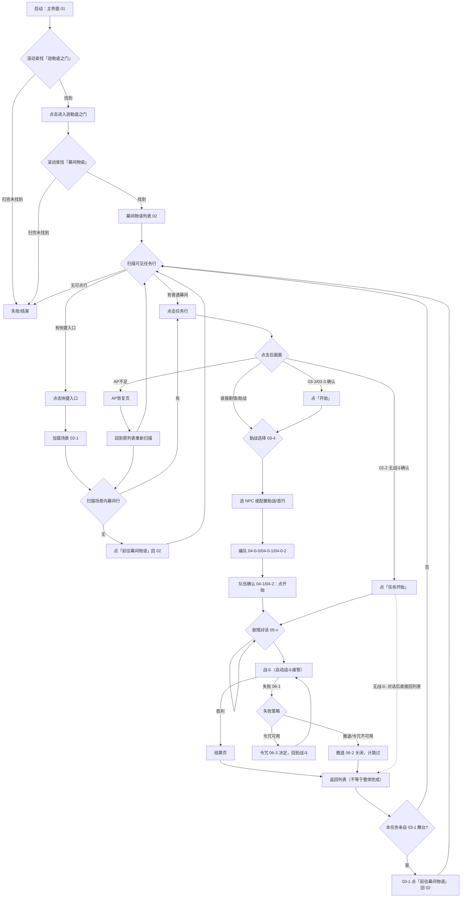

# 幕间物语自动推关流程（设计稿）

> 状态：流程定稿并已落地首版实现；第 15 节为实机调参/验证项。截图见 `dev/shots/幕/`（PNG 实际格式，扩展名为 `.jpg`）。
> 目标：在「战斗」菜单下新增「幕间物语」任务，从主界面自动进入幕间列表，自动完成幕间关卡：选任务 → 确认 → 助战 → 编队 → 跳过剧情 → 自动战斗 → 结算 → 回列表继续；失败按配置撤退或使用令咒。

## 1. 边界

- 首版仅国服（截图均为国服；强化任务也仅国服）。
- **启动点为主界面（01）**，自动导航：主界面 → 迦勒底之门 → 幕间物语 → 任务列表。01 主界面、迦勒底之门菜单、02 任务列表都是动态/可滚动列表，入口位置不固定，需要滚动查找。
- **舞台任务完成后直接回到 02 任务列表**（用户反馈）；实现上兼容「停在 03-1」的情况：看到 03-1 就点左上「前往幕间物语」回 02，看到 02 就直接继续。左上「关闭」只关闭列表、停留在当前场景，不使用。
- 只接受「干净」的主界面：启动时如果有登录奖励/公告弹窗，不做自动关闭，直接报错提示用户先处理。
- 战斗全程交给「自动战斗接管」，不提供手动技能/宝具/出卡配置；任务页单独配置支援角色、自动战斗方案、AP 恢复、失败策略。**不选项目/队伍，不复用项目配置。**
- 圣晶石续关不使用。
- 所有判断以 1920×1080 归一化坐标描述；实际实现走模板/探针，不写死视觉坐标。

## 2. 页面清单

| 编号 | 页面 | 关键锚点 | 处理 |
| --- | --- | --- | --- |
| 01 | 主界面（终端） | 左下等级/AP、右下「菜单」、右侧竖排入口 | 滚动查找「迦勒底之门」入口；只接受干净主界面 |
| 02 | 迦勒底之门菜单 | 顶部标题「迦勒底之门」、右侧竖排入口 | 滚动查找「幕间物语」入口 |
| 02 | 幕间物语列表 | 右上标题「幕间物语」、右侧任务卡 | 扫描/选择任务 |
| 02 | 普通幕间行 | 标题 + `Interlude` + 「消耗」+「任务进行度」 | 点击进入确认/直接助战 |
| 02 | 不可选择行 | 整行变暗/黑色剪影 + 「第六特异点通关&…后开放」等条件文字 | 跳过，不点 |
| 02 | 快捷入口行 | 标题 + 从者名 + 「前往故事的舞台 Quick Link」 | 点击进入场景列表 |
| 02-1 | 无战斗幕间行 | 普通幕间行 + 行右上角红色「无战斗」 | 点击进入 02-2 |
| 02-2 | 无战斗确认 | 标题为任务名 +「该任务没有战斗」+「取消/任务开始」 | 点「任务开始」→ 对话 → 回列表 |
| 03-1 | 场景任务列表 | 左上「关闭」+「前往幕间物语」、右上场景名 | 扫描/选择场景内幕间；完成后直接回 02（兼容 03-1 时点「前往幕间物语」） |
| 03-1 | 自由关卡行 | 「自由关卡」+「- 完成 -」 | 跳过 |
| 03-2 | 确认任务 | 弹窗「该关卡将在战斗前进行编队」+「取消/开始」 | 点「开始」 |
| 03-3 | 规定回合数 | 弹窗「无法在规定回合数内…」+「取消/开始」 | 可选；点「开始」后再出现 03-2 |
| 03-4 | 助战选择 | 顶部「助战选择」；NPC 行有「客将从者」/「NPC」角标 | NPC 优先，点整行 |
| 04-0-0 | 编制限制弹窗 | 「编制限制」+「关闭」 | 点「关闭」 |
| 04-0-1 | 自动编成确认（特殊关卡） | 「自动编成执行确认」+「不进行自动编成/详细设定/自动编成」 | 按配置选择 |
| 04-0-3 | 自动编成确认（有空位/底部按钮） | 「自动编成」+「取消/详细设定/自动编成」 | 点「自动编成」→ 04-0-2 → 决定 |
| 04-0-2 | 队伍编制（自动编成结果） | 「队伍编制」+ 右下「决定」 | 点「决定」 |
| 04-1 | 队伍确认（普通） | 六格队伍 + 右下「开始任务」 | 点「开始任务」 |
| 04-1 | 队伍确认（有空位） | 空槽显示「选择」、底部「自动编队」 | 点「自动编队」补人后再开始 |
| 04-2 | 队伍确认（固定/仅助战） | 六格队伍 + 右下「战斗开始」 | 点「战斗开始」 |
| 05-1 | 剧情对话 | 右上「跳过 ▶」+ 底部对话框 | 点「跳过」 |
| 05-2/3 | 对话选项 | 1～3 个黑底蓝边选项框 | 选第一项 |
| 05-4 | 跳过确认 | 「是否跳过该段剧情？」+「否/是」 | 点「是」 |
| 06-1 | 战斗失败续关 | 「续关」+「撤退/使用令咒/使用圣晶石」 | 按配置；圣晶石不用 |
| 06-1a | 撤退二次确认 | 「是否要撤退？」+「取消/决定」 | 点右侧「决定」 |
| 06-2 | 已撤退提示 | 「已从任务中撤退」+「关闭」 | 点「关闭」 |
| 06-3 | 令咒确认 | 「是否使用3划令咒进行续关？」+「取消/决定」 | 点「决定」 |

## 3. 总体流程

剧情对话是**全局中断**：在 `03-2` 点击开始之后、编队之前、点击战斗开始之后、战斗结束后都可能出现，处理优先于其它阶段推进。

## 4. 任务列表与选择

### 4.1 行类型

- 普通幕间：`Interlude` 小标题 +「消耗 AP」+「任务进行度」进度箭头 + 右侧推荐等级/职阶/奖励。
- **任务进行度**：行内箭头表示该任务需要连续完成多次才从列表移除；标题不变，行类型（普通/快捷）不切换；「无战斗」是同一行的临时状态，可能在某一步出现、完成后消失。每一步仍按实际画面判断，不缓存上一步状态。
- 快捷入口：标题 + 从者名 +「前往故事的舞台 Quick Link」，没有 AP/进行度。
- 自由关卡（仅 03-1）：绿色「自由关卡」+「- 完成 -」，不是幕间，跳过。
- 无战斗幕间：普通幕间行右上角有红色「无战斗」标记（行内右上，不是行尾）。点击后出现 02-2 确认框：标题为任务名，正文「该任务没有战斗」，右按钮是「任务开始」。
  - 点「任务开始」后直接进入剧情，没有助战/编队/战斗；剧情跳完后回到任务列表，算完成**当前一步**，是否整体完成看标题是否从列表移除。

### 4.2 可点击判定

- 行亮度足够、未被底部「菜单」按钮遮挡、行完整落在可见区间。
- **不可选择行**：整行变暗/黑色剪影，并显示「第六特异点通关&灵基再临第3阶段&牵绊Lv.10后开放」这类条件文字；直接跳过，不点、不加入已处理。
- 「新!」、「开放条件缓和中! 剩余 N 日」等横幅只是装饰，不参与判定。
- 不依赖「AP 0」文本：活动期 0 AP、平时有消耗，行识别锚点用「消耗」「任务进行度」「Interlude」。
- 「无战斗」标记只用于日志/可选跳过；不需要靠它决定流程，02-2 确认框本身会说明「该任务没有战斗」。
- 已完成的幕间会从列表移除（用户确认），不需要靠已处理名单防止重复点击；已处理名单只用于撤退/取消/空场景快捷行。

### 4.3 入口导航（主界面 → 迦勒底之门 → 幕间物语）

- 主界面（01）和迦勒底之门菜单都先点击右侧滚动条顶部一次；随后在可见区域用文字或入口横幅模板查找，未找到就向下滚动后再查，达到扫描上限仍未找到则报错。
- 找到后点入口，进入迦勒底之门菜单；菜单同样可能滚动，查找「幕间物语」文字/入口图标，找不到就滚动。
- 点击「幕间物语」后进入 02 任务列表；之后每次完成/撤退都回 02，不再重新走主界面导航。
- 只接受干净主界面：启动时识别到登录奖励/公告弹窗等非预期画面，直接报错提示用户先处理，不自动关闭。
- **舞台任务完成/撤退后**：用户反馈会直接回 02 任务列表；实现兼容停在 03-1 的情况，看到 03-1 就点左上「前往幕间物语」回 02。左上「关闭」不使用。

### 4.4 任务扫描与选择

- 进入幕间列表或舞台列表后，从当前位置扫描**当前可见行**，不强制回到顶部。当前页没有可点目标时再向下滚动。
- 全模式：取当前可见的最上面一个可点、未处理的行；完成一步回列表后，重新看当前界面：
  - 同一标题还在且可点 → 继续点它（下一步）；
  - 不在当前界面 → 先做其它可点行；
  - 当前界面没有可点行 → 向下滚动找。
- 指定模式：截图后在 02 列表点选一行（普通行或快捷入口行都允许），之后只做这个标题：
  - 目标在当前界面 → 点它；不在 → 滚动查找；
  - 被透明遮罩/暂时不可点 → 最多等 3 轮（可配置），仍不行报错停止；
  - 不做其它任务；目标标题从列表消失即完成。
- **不专门为某个标题做全列表搜索**；全模式顺序不重要，重要的是把当前能打的行都打完。暂时没看到的任务，等其它行完成后自然会重新出现。
- 02 列表到底后，若没有可点行 → 本次结束；03-1 列表到底且没有可点幕间行 → 点「前往幕间物语」回 02。
- 结束报告：完成 N 个幕间、跳过 M 个、剩余不可点/遮罩 K 个（用于判断是条件未满足还是被锁）。
- 快捷入口进入的场景若已没有可点幕间，记录该快捷行标题，避免反复进入（防死循环）。
- 完成的任务会从列表移除；撤退/03-3 取消的任务仍在列表里，需要靠已处理标题跳过。
- 暂时不可挑战的行（黑色/透明遮罩 + 条件文字，见 02-不可选择任务）跳过，不加入已处理；它恢复可点后会被重新扫到。
- **多步任务不按“回列表 = 完成”**：回列表只代表当前一步结束；行还在就继续，行从列表移除才完成。

### 4.5 任务进行度 / 多步任务

- 同一个标题可能要求完成 2～N 次（行内箭头数）；标题不变，行类型（普通/快捷）不变，「无战斗」只是临时状态，可能出现/消失。
- **不判断当前进度**：只判断「跳过」或「继续完成」；行只要还在且可点，就会在下一轮扫描里被再次选中。
- 不解析箭头数量，不专门搜索某个标题：
  1. 扫描当前可见行，取一个可点、未处理的行；
  2. 完成一步，回 02（或 03-1 回 02）；
  3. 重新看当前界面：同标题可点就继续；否则做其它可点行；没有就滚动。
- 中间步骤是无战斗时，02-2 → 任务开始 → 对话 → 回 02；该行还在就继续。
- 中间步骤是快捷入口时，点行 → 03-1 → 按标题找到目标 → 完成 → 回到 02；该行还在就继续。
- 跳过当前标题的条件：已在已处理名单（撤退/03-3 取消）、当前行黑色/透明遮罩不可点、按标题找不到；但先做其它可点行，所有能打的都打完后再决定是否结束。跳过不等于完成。
- 防死循环：同一标题连续尝试上限（默认 10，可配置）；超过则加入已处理并报错/继续下一个。
- 完成计数（Q41 b）：正常滚动扫描时记录出现过的标题集合；完整扫描一轮后某标题不再出现 → 视为整体完成，`completed_count += 1`；多步任务只计 1 次；跳过/已处理不计。
- 全模式结束：完整扫描一轮没有可点行即结束；仍有透明遮罩/不可点行则留给下次运行，不等待。
- 行暂时不可点（变暗/加载中）时等待，不要立刻跳过；持续不可点超过阈值再按失败处理。

### 4.6 AP 不足

- 点击任务行后可能直接打开 AP 恢复页（与强化任务相同），而不是 03-2。
- 交给现有 AP 恢复流程消耗已配置道具；恢复后回到原列表，重新识别并点击同一行。
- 恢复道具用尽/未配置 → 按现有流程结束运行。
- 不预先读取左下 AP 条，也不按行消耗做预判。

## 5. 任务确认

- 03-2（普通）：右按钮「开始」，点它。
- 03-3（规定回合数）：比 03-2 多一层提示；点「开始」后还会出现 03-2。
  - 勾选「允许规定回合数任务」：按 03-3 → 03-2 → 开始处理。
  - 未勾选：遇到 03-3 点「取消」，把该任务加入跳过名单，继续下一个。
- 02-2（无战斗）：右按钮「任务开始」，点它后直接进入剧情，没有助战/编队/战斗；剧情跳完回列表，算完成当前一步（标题还在就继续下一步）。
- **有的任务点击后不出现任何确认弹窗，直接进入助战选择**；状态机必须把「点行后直接看到助战/队伍确认」当作正常路径，不能等 03-2。
- 点击任务行后可能出现的画面：03-2/03-3、02-2、剧情、助战、队伍确认、AP 恢复；按实际画面分支。

## 6. 助战

- 有 NPC 优先 NPC：
  - 识别「客将从者」栏或行尾「NPC」角标的行，点整行。
  - 若列表不在顶部，先回顶部再扫描。
  - NPC 行存在但不可点/识别失败 → 回退到下一级策略。
- 无 NPC：
  - 使用幕间任务页**单独配置**的支援角色（不复用战斗队伍的项目配置）。
  - 支援配置复用现有助战面板的完整筛选：从者、概念礼装、等级/宝具/技能/星图下限。
  - 未配置支援角色 → 取列表首行（「任意」，不做真随机）。
- 幕间模式不配置队伍：存在强制 NPC 的关卡，队伍配置没有意义；任务页只配置支援 + 自动战斗。

## 7. 编队

- 进入编队后可能先弹 04-0-0「编制限制」：点「关闭」。
- 如果出现「选择编队来源」弹窗，先点「从助战中编队」进入助战选择；选好 NPC 返回队伍确认后，直接继续战斗，不再重复点击已填好的限制栏位。
- 队伍确认页若被「编成条件」弹窗遮挡，先点「关闭」，回到队伍确认后再检查空位内的「编队限制」文字（在「选择」位置上方）。命中后先检查右侧编队条件说明；要求指定从者时，不视为 NPC 已满足条件，并停止报告限制。否则再检查该栏位是否已有 NPC 角标；已填入就跳过点击并继续战斗，未填入才点该栏位选择 NPC。回到队伍确认后，同一栏仍匹配限制文字时先尝试开始战斗；若弹出「先发成员不足」，先关闭并有限重试受限栏位。
- 04-0-1「自动编成执行确认」（特殊关卡自动弹出）：
  - 三按钮：左「不进行自动编成」/ 中「详细设定」/ 右「自动编成」。
  - 按配置选「自动编成」或「不进行自动编成」。
  - 点「自动编成」→ 04-0-2 → 点「决定」→ 回到队伍确认。
  - 点「不进行自动编成」→ 使用当前队伍。
- **队伍有空位（至少 1 个从者，其余槽位显示「选择」）**：
  - 不直接开始，先点下方的「自动编队」按钮补人。
  - 弹出 04-0-3，三按钮：左「取消」/ 中「详细设定」/ 右「自动编成」；左按钮只是文字从「不进行自动编成」变成「取消」，位置不变。
  - 点「自动编成」→ 04-0-2 → 「决定」→ 回到队伍确认。
  - 空位判定：六格区域出现「选择」占位（模板匹配）；队伍至少 1 个从者，不存在全空队伍。
  - 固定编队 04-2 的空槽显示「只有助战可以出击」，不是「选择」，不会触发自动编队。
- 04-1 / 04-2 都是队伍确认页：
  - 04-1 右下是「开始任务」，04-2 右下是「战斗开始」，位置相同，点是。
  - 04-2 的「出击成员固定」「只有助战可以出击」、按钮遮罩禁用都不处理，直接开始。
- 队伍校验：
  - 完全跳过队伍校验、队伍顺序调整、指定从者放置、御主礼装切换。
  - 不校验不等于不管：队伍有空位时走上一条「自动编队」流程。
- 开始按钮不可点/不存在且没有「自动编队」可点 → 明确失败，不空点。

## 8. 剧情对话

**对话不是某个阶段的一步，而是任务流程内的全局中断。** 实现时保留全局对话处理作为兜底；实际会出现的时机如下：

1. 03-2/03-3/02-2 点开始后、助战选择前（「还没进编队时」）。
2. 编队确认后、点击开始前/后（「编好队开始战斗时」）。
3. 点击开始任务/战斗开始后、Battle 出现前。
4. 一场战斗结束后、结算页出现前（「战斗结束后」）。
5. 结算页之间、结算 Continue 关闭后、回列表前（尾声）。
6. 无战斗任务：02-2 任务开始后到回列表，可能多段。
7. 点击「前往故事的舞台」加载场景时（场景开场剧情）。

已确认**不出现**对话的时机（不按这些设计）：点任务行后/确认弹窗之前、助战选择后/编队之前、多段战斗之间、撤退/令咒失败后、回到 02 列表后。

处理规则：

- 全局优先：任何阶段检测到 Dialog，先处理对话，再继续原阶段；所有 phase 的页面分类器都必须把 Dialog 视为「可接受的中断」，不能报未知页面。
- 所有等待门遇到 Dialog 都不计超时/失败，暂停或重置计时：确认等待、离开等待、战斗加载等待、结算等待、返回等待、场景加载等待。
- 对话可能连续多段，中间夹黑屏/加载/Unknown；设置对话宽限期（如 15s），宽限期内 Unknown 不按普通超时处理。
- 无选项：点右上「跳过」→ 05-4 点「是」。如果跳过按钮不存在/不可点且没有选项，尝试点击对话框逐句推进（待确认是否支持）。
- 有选项：识别 1～3 个选项框，点第一个（最上面），按检测到的实际位置点；选项可能连续出现。
- 选项出现时「跳过」可能被禁用/无效，此时不要反复点跳过，先选选项再恢复跳过。
- 多段战斗/多步任务：一次胜利或一次回列表不等于整体完成；只有标题从列表消失才计完成。

## 9. 战斗与结算

- 战斗页复用现有自动战斗；强制「自动战斗接管」，不跑手动技能轴。
- 冠位/高级模式队伍：首版强制按普通模式处理（自动战斗接管不支持高级模式）。
- 忽略队伍的「五星礼装掉落停止 / 羁绊升级停止」等结算停止项，保证「推完」语义。
- 胜利后走现有结算链（战利品/经验/羁绊/Continue），Continue 页点「关闭」。结算后若画面未知且无法识别报酬按钮，剧情宽限期结束后可补点屏幕，最多 3 次、相邻点击至少间隔 3 秒，再按原等待和恢复流程处理。
- 结算或尾声后若弹出新幕间物语「已开放！」提示，点击右侧「前往幕间物语」，等待返回幕间列表。
- 如果一场胜利后又出现 Battle（多段战斗），继续打，不提前计完成。
- 结算关闭后回到 02/03-1：**回列表只代表当前一步结束**；看当前界面，行还在且可点就继续，不在当前界面就先做其它可点行；不专门搜索某个标题。
- 无战斗幕间：02-2 点「任务开始」→ 跳过剧情 → 直接回列表；同样按「行是否还在且可点」继续。

## 10. 失败处理

- 06-1 出现时按配置：
  - 「撤退」（默认）：点「撤退」→ 若出现 06-1a 则点「决定」→ 06-2 点「关闭」→ 回列表；把该任务**标题**加入本次运行的已处理名单，继续下一个。
  - 「使用令咒」：先探测「使用令咒」按钮是否存在且为亮色可点，并取实际位置再点；出现 06-3 后点「决定」，回到战斗并重置战斗轮次状态。
  - 令咒按钮缺失/不可点 → 强制走撤退。
  - 本次运行内令咒用过后再次失败 → 直接走撤退（仍先探测按钮）。
- 「使用圣晶石」永不点击。
- 单模式撤退后：目标已失败，本次运行没有其它目标任务 → 结束并提示失败。
- 全模式撤退后：按标题跳过该任务（含后续所有步骤），继续扫描；不能按行号跳过（行会移位）。
- 多步任务中途撤退/03-3 取消：整个标题加入已处理名单，后续步骤本次运行都不再尝试。
- 舞台任务撤退后若停在 03-1，点「前往幕间物语」回 02；若直接回 02 则继续。
- 只有识别到本场舞台战斗的结算画面后，才允许通过菜单恢复。此前的场景加载仍正常等待，超时则停止。结算后的未知画面若匹配右下角「菜单」按钮，立即点击并进入恢复，不必等到重试上限。若未提前识别到菜单，连续等待达到「舞台恢复重试次数」（默认 30）后，再用 OCR 检查并点击「菜单」。然后点「终端」。确认回主界面后重新走「迦勒底之门 → 幕间物语」，保留本次任务记录。未检测到菜单则停止；等待终端入口或主界面超出限制也停止。
- 已处理名单只在本次运行内有效；下次运行重新尝试该关。

## 11. 内部状态机（草案）

任务级 phase：

| phase | 含义 | 主要出口 |
| --- | --- | --- |
| `NavigateMain` | 在 01 主界面滚动查找「迦勒底之门」 | 找到并点击 → `NavigateGate`；扫完未找到 → 失败 |
| `NavigateGate` | 在迦勒底之门菜单查找「幕间物语」 | 找到并点击 → `NeedRootList`；扫完未找到 → 失败 |
| `NeedRootList` | 在 02 列表扫描当前可见行 | 有可点行 → 点它（普通行 → `AwaitingConfirm`；快捷行 → `AwaitingStage`）；无可点行 → 向下滚动；完整扫描无可点行 → 结束 |
| `AwaitingStage` | 等待 03-1 场景列表 | 看到 03-1 → `NeedStageList` |
| `NeedStageList` | 在 03-1 扫描 | 点幕间行 → `AwaitingConfirm`；无行 → 点「前往幕间物语」→ `NeedRootList` |
| `AwaitingConfirm` | 等待 03-2/03-3/02-2/剧情/助战/AP恢复 | 点「开始」/「任务开始」→ `AwaitingDeparture`；AP恢复 → 回列表；对话 → 全局处理 |
| `AwaitingDeparture` | 已点确认，等待助战/队伍确认 | 看到助战或队伍确认 → `InQuest`；对话 → 全局处理；AP恢复 → 回列表 |
| `InQuest` | 助战/编队/战斗/结算 | 结算 Continue 关闭 → `AwaitingReturn`；无战斗任务对话后看到列表 → `AwaitingReturn` |
| `AwaitingReturn` | 结算关闭或撤退后等列表 | 看到 02 → `NeedRootList`；看到 03-1 → 点「前往幕间物语」→ `NeedRootList` |

跨 phase 状态：

- `current_list`: `Root` / `Stage`，决定返回后去哪。
- `handled_titles`: 已撤退/03-3 取消/空场景快捷行的任务标题集合（仅本次运行）。
- `seen_titles`: 当前完整扫描轮次出现过的标题集合，用于确认某标题是否已从列表移除。
- `repeat_attempts`: 同一标题连续尝试次数，达到 `max_repeat_attempts`（默认 10）则加入已处理并报错/继续下一个。
- `completed_count`: 本轮整体完成的任务数（完整扫描后标题不再出现时 +1，含无战斗任务；按任务不按步数；多步任务只计 1 次）。
- `single_mode_wait_rounds`: 单模式下目标暂时不可点时的等待轮数，超过 3 轮报错停止。
- `end_report`: 结束时输出完成/跳过/剩余不可点数量。
- `charm_used_this_run`: 令咒是否已用过。
- `selected_title`: 指定模式的目标标题。
- `navigation_done`: 从 01 导航到 02 后置位；本次运行不再重走主界面。

全局拦截顺序建议：`剧情对话` → `06-x 失败` → `AP恢复` → 具体页面 handler。对话与失败页可能夹在任意阶段之间。

`Dialog` 不是独立 phase：`NeedRootList`、`NeedStageList`、`AwaitingStage`、`AwaitingConfirm`、`AwaitingDeparture`、`InQuest`、`AwaitingReturn` 遇到都要先处理并暂停/重置等待计时；`NavigateMain`、`NavigateGate` 理论上不应出现剧情对话，遇到按未知画面报错。

## 12. 与现有代码的映射

| 层 | 改动 |
| --- | --- |
| `screen/types.rs` | 新增 `Screen`：`Main`、`ChaldeaGate`、`InterludeQuest`、`InterludeStage`、`QuestConfirm`（03-2/03-3/02-2 变体）、`Dialog`、`FormationDialog`、`FormationRestricted`、`BattleContinue`、`RetreatNotice`、`CharmConfirm`（名称待定） |
| `cv.json`（cn） | 新画面 detect/变体/元素与模板：主界面入口、迦勒底之门菜单、列表标题/行锚点、三种确认弹窗、跳过按钮、选项框、编队弹窗、决定/战斗开始按钮、失败页按钮 |
| `sidecar/cv.py` | 新增行检测（普通/快捷/自由/无战斗标记）、NPC 行检测、对话选项检测、令咒按钮存在性检测、入口文本/图标检测 |
| `runner/interlude_quest.rs` | 新任务运行时（仿 `rank_up_quest.rs`），管理 phase、导航、当前可见行扫描、按标题的已处理名单与重复保护、完成计数 |
| `runner/` 导航模块 | 主界面/迦勒底之门入口查找与滚动；03-1 的「前往幕间物语」返回；找不到时明确报错 |
| `runner/prebattle.rs` | 幕间任务跳过队伍校验/顺序/从者放置/御主礼装；支持「开始任务」「战斗开始」两种按钮；队伍有空位时点「自动编队」并处理 04-0-3（左按钮「取消」） |
| `runner/results.rs` | `interlude_quest_active()` 分支：关闭结算 → 标记返回；**不在这里计完成**，完成由标题是否消失决定 |
| `runner/engine.rs` | 对话全局处理；所有等待门（确认/离开/战斗加载/结算/返回/场景加载）遇 Dialog 暂停或重置计时；新画面路由；主界面/迦勒底之门路由 |
| `runner/state.rs` | 战斗失败/令咒复活后的战斗状态重置；战斗加载等待遇 Dialog 不计超时 |
| `runner/config.rs` + commands | `InterludeWorkflowConfig`、`start_interlude_automation`、截图选择命令、独立配置（支援/自动战斗方案/AP 恢复/失败策略） |
| 前端 | 新 `InterludePage.tsx` 独立配置页、独立 types、App 路由、战斗菜单卡片（幕间物语放 03，自动战斗改 04）、feature toggle、测试；不改动其它页面逻辑 |
| 文档 | 实现后补 `docs/state-machines/interlude-quest-automation.md` 并登记到 `docs/README.md` |

## 13. 识别清单（需新增）

- 导航：01 主界面锚点；「迦勒底之门」入口文字/横幅；迦勒底之门菜单「幕间物语」入口文字/图标；03-1 左上「前往幕间物语」；主界面/菜单滚动条或滑动边界。
- 列表：02 标题；03-1「前往幕间物语」按钮；行锚点「Interlude」「消耗」「前往故事的舞台」「自由关卡」；行标题区域（图像模板）；不可选择行的暗色/条件文字；行右上「无战斗」；滚动条复用。
- 确认：03-2「开始」、03-3「开始」、02-2「任务开始」三种弹窗区分；02-2 正文「该任务没有战斗」。
- 助战：NPC 角标/「客将从者」；任务页独立支援配置的助战搜索沿用现有能力。
- 编队：04-0-0 标题+关闭；04-0-1（左「不进行自动编成」）与 04-0-3（左「取消」）三按钮版按左按钮模板区分；04-0-2「决定」；04-2「战斗开始」；底部「自动编队」；空槽「选择」占位。
- 对话：右上「跳过」；05-4「是」；选项框 1～3，按实际检测位置点击。
- 失败：06-1 标题「续关」/三个按钮；06-3「决定」；06-2「关闭」；令咒按钮亮/暗两态。

## 14. 配置项草案

- 新界面独立配置，不选项目/队伍，不复用项目配置；不改动战斗页、强化任务页等其它界面。
- 完成方式：全部可完成 / 指定任务（截图选择，普通行和快捷入口行都可选）。
- 支援角色：任务页单独配置，复用现有助战面板完整筛选（从者、概念礼装、等级/宝具/技能/星图）。
- 自动战斗方案：从全局自动战斗方案列表选择；不读任何队伍的方案。
- AP 恢复：任务页自带一份配置（仅一份，不复制多份）。
- 自动编成：自动编成 / 不进行自动编成；队伍有空位时强制走底部「自动编队」+ 04-0-3。
- 规定回合数任务：允许 / 不允许（默认不允许）。
- 战斗失败：撤退（默认）/ 使用令咒；连续撤退/识别失败达到 N 次（默认 3，可配置）停止。
- 多步任务：同一标题连续尝试上限（默认 10，可配置），超过则加入已处理并报错/继续下一个。
- 舞台恢复：连续等待重试上限（默认 30，可配置），与同一标题尝试次数独立。
- 完成计数：完整扫描后按「标题不再出现」计 1 次；多步任务只计 1 次。
- 单模式：目标暂时不可点时等待 3 轮（可配置），仍不行报错停止。
- 启动：接受 01 主界面，也接受已停在 02/03-1；主界面有弹窗直接报错。
- 菜单顺序：战斗菜单 01 编队/开始、02 强化任务、03 幕间物语（新）、04 自动战斗（原 03 顺延）。

## 15. 待实机验证

1. 主界面「迦勒底之门」入口、迦勒底之门菜单「幕间物语」入口的滚动方向、最大查找次数；活动换 banner 时文字/图标模板是否稳定。
2. 登录奖励/公告弹窗的形态（首版不处理，只用于报错文案）。
3. 舞台任务完成后是否稳定直接回 02；若偶尔停在 03-1，左上「前往幕间物语」是否可用、返回后是否在 02 顶部；「关闭」不要误点。
4. 普通 02 任务完成后是否直接回 02 列表（不需要回主界面）。
5. 快捷入口对应的幕间完成后，02 列表的快捷行是否消失（用户反馈完成的任务会从列表移除）。
6. AP 不足时打开 AP 恢复页的时机（点行时 / 点确认后），恢复后回到 02 还是 03-1。
7. 令咒不足 3 划时按钮是消失、变暗还是仍可点。
8. 对话选项出现时「跳过」是隐藏、变暗还是仍可点。
9. 是否存在跳过按钮不可用且没有选项的强制剧情；需要「点对话框逐句推进」还是直接报错。
10. 幕间是否存在多段战斗/多波次；胜利后是直接结算页，还是再进 Battle（不需要中间对话）。
11. 对话多段之间黑屏/加载的最长时间，用于设定对话宽限期。
12. 04-2「战斗开始」、04-0-2「决定」、04-0-3（左「取消」）与 04-0-1（左「不进行自动编成」）的模板差异。
13. 战斗结束后剧情在结算前还是结算后。
14. 撤退后回到 02 还是 03-1；舞台任务撤退是否也直接回 02。
15. 固定编队（04-2）是否还会经过助战选择。
16. 队伍空位的「选择」占位是否稳定可用于判定。
17. 标题区域图像匹配在英文/中文标题、字体缩放下的稳定性。
18. 不可选择行的暗色/条件文字识别是否稳定（如「第六特异点通关&灵基再临第3阶段&牵绊Lv.10后开放」）。
19. **任务进行度**：箭头数是否等于需要完成的次数；每一步完成后行是否保留、无战斗状态是否临时出现/消失；行类型是否始终不变。
20. **多步任务中间态**：无战斗步骤完成后行是否短暂不可点/加载，持续多久；同标题最多几步（默认上限 10 是否够）。
21. **多步任务中断**：中途撤退/03-3 取消后，下次运行是从头开始还是保留进度。
22. **透明遮罩**：02-不可选择任务的黑色/透明遮罩行如何稳定识别；跳过它之后恢复可点是否会被重新扫到。
23. **完成计数**：一轮完整扫描的边界（滚动到底、列表过滤/排序）是否足以确认标题已移除；完成提示用什么文案。
24. 国服列表字体缩放是否影响「Interlude」「消耗」「无战斗」锚点（强化任务已有 0.75–1.0 多尺度先例）。
