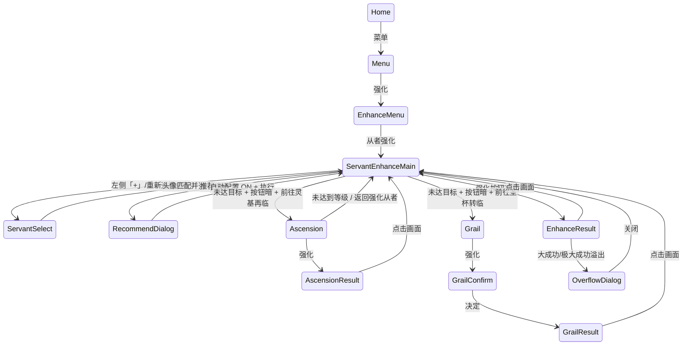
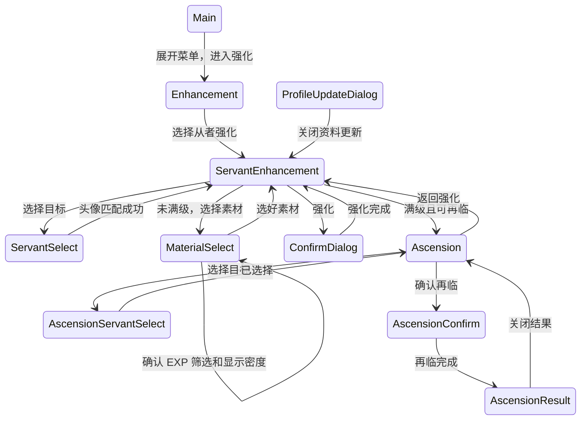

# 从者强化

从者强化有两条独立实现：

- **国服 · 多从者队列**：[servant_enhancement](../../src-tauri/src/servant_enhancement/) 与其命令 [automation/servant_enhancement.rs](../../src-tauri/src/commands/automation/servant_enhancement.rs)。主页「从者强化」卡片进入，后台持久化队列并逐个执行。
- **日服 · 单目标旧流程**：[enhancement_runner.rs](../../src-tauri/src/enhancement_runner.rs) 及其同名目录，命令位于 [automation/enhancement.rs](../../src-tauri/src/commands/automation/enhancement.rs)。

两条流程都遵循[公共生命周期约定](README.md)。

## 国服多从者队列

### 画面流程

主界面、灵基再临、圣杯转临共用右下角「强化」按钮。按钮亮 = 可执行；按钮暗 = 不可执行。主界面先用当前等级判断是否达到用户目标；未达到时，按钮亮则执行，按钮暗且存在「前往灵基再临」/「前往圣杯转临」则进入对应页面，没有入口则尝试一次推荐选择。推荐选择后按钮仍暗才跳过，不推断素材或量子余额。

### 画面识别

国服页面导航依赖 OCR 文本，执行条件读取按钮亮度；当前等级另走专用图像分割与数字识别，不新增 `cv.json` screen：

| 画面 | 判定文本 |
| --- | --- |
| 主页 | `通知` + `菜单` |
| 菜单展开 | `个人空间` / `召唤` |
| 强化菜单 | `从者技能强化` / `概念礼装强化` |
| 从者强化主界面 | `强化用素材` / `请先选择想要强化的从者` |
| 从者选择列表 | `请选择想要强化的从者` / `持有从者` / `等级顺序` |
| 推荐素材选择 | `推荐素材选择` |
| 强化二次确认 | `包含★3以上的素材` / `是否进行强化合成` |
| 强化结果 | `请点击游戏界面` / `已到达等级上限` / `习得新的技能` / `圣肖像进化` |
| 经验溢出提示 | `经验值溢出` / `并未使用` |
| 灵基再临 | `灵基再临结果` / `灵基再临必要道具` |
| 圣杯转临 | `圣杯转临结果` / `圣杯转临所必需` |
| 圣杯转临确认 | `是否进行` + `圣杯转临` |

按钮亮度读取右下角 `(0.833, 0.895, 0.035, 0.06)` 区域的平均流明：约 `195` 为亮、`100` 为暗，阈值 `150`。是否可执行只依赖这个亮度，不读取或推算素材、量子、圣杯、从者币数量；画面文字仅用于页面识别和导航。

### 当前等级读取

- 国服队列使用独立的 `read_enhancement_current_level` sidecar 请求。以实际 1920×1080 视频帧中的 `(634, 670, 259, 86)` 为等级区域，按归一化坐标取图后统一到该尺寸。先通过白色连通笔画的细长比例、负斜率与直线残差定位斜杠，再仅裁出它左侧的完整数字；不读取右侧等级上限、材料等级或强化后预览。
- 数字图去掉背景后交给 PP-OCRv6 的纯文字识别接口，跳过全文检测。只接受 1～3 位完整数字、识别位数与图像中的数字数一致、置信度至少 `0.95`，并满足 `1 <= 当前 <= 150`。缺失/多个斜杠、数字不完整或不对齐、低置信度均拒绝；不会将 OCR 的 `371` 直接截成 `37`，也不回退到整屏 `当前/上限` OCR 或日服/战斗数字模板。
- Rust 在相隔至少 `250ms` 的两次独立帧请求中读到相同当前等级后才接受。只用 `当前 >= 目标` 判断完成，不再依赖当前上限，状态中的 `maxLevel` 留空。
- 选择后、每次强化后与动画等待中的等级复查使用同一路径。失败日志包含数字原文和明确的分割/识别失败原因，连续 7 次失败才跳过，并保留队列条目供下次重试。
- [当前等级截图裁剪](../../sidecar/cv-code/tests/test_data/enhancement-level-cn/README.md) 与 [专用读取测试](../../sidecar/cv-code/tests/test_enhancement_level.py) 覆盖真实 `1/40`、`37/40`、`40/40`、`80/80`，以及由真实字形组合的三位数、1920×1080 / 2560×1440、斜杠缺失/歧义、空白及低置信度。Rust 测试覆盖双帧一致性、当前等级目标判断与按钮决策。

### 从者选择与 2EXP

- 进入列表后先打开「筛选」，按目标的稀有度和职阶过滤（1920×1080 固定布局：稀有度行 y≈0.343，职阶行 y≈0.548，`决定` x≈0.86/y≈0.87），先点「回到初始设定」清空上次勾选，再勾选目标稀有度/职阶，把候选压到一页内，避免依赖不稳定的列表滚动；筛选后网格头像匹配阈值为 `0.60`，普通列表为 `0.85`。筛选未识别成功时回退到滚动列表，筛选请求错误正常上报。
- 列表使用现有 `find_enhancement_servant_grid` 头像匹配；国服 1920×1080、7 列布局沿用归一化网格参数。国服 anchor 模板 `text_servant_avatar_bottom_line.png` 必须覆盖卡片底部整条栏（2560 参考宽度下约 268×31），文字小图会让网格整体右移。
- 国服网格未命中时，在同一个列表区域直接搜索目标头像裁剪，仍使用当前分辨率对应的模板尺寸、指定头像和 2EXP 遮罩。直接搜索阈值至少 `0.85`，不会沿用筛选网格的低阈值；因此 `anchors=0` / `cells=0` 或只露出头像的底部半行也能参与匹配。日服保持原路径。诊断记录 `matchMethod`、`directSearchAttempted`、`gridFailReason` 与直接搜索阈值；Rust 日志区分网格/直接搜索并带失败原因。
- 离线截图 `tests/test_data/screenshots/servant_select_cn_partial.png` 与独立头像模板覆盖 1920×1080 / 2560×1440、零锚点、底部半行、无目标、指定其他再临头像、列表边界和 2EXP 遮挡。
- 每个条目可指定头像（`face_key`）。指定后只用该头像模板；不指定时才尝试该从者的全部头像。不同再临头像视为不同识别目标，不做跨头像回退。
- `two_exp` 是识别提示：先带 2EXP 遮罩区域（`maskRegion`）以 `0.72` 阈值尝试，再回退无遮罩的 `0.85` 普通匹配。命中/回退都会写日志。
- 2EXP 遮罩由 sidecar 的 `_build_mask_for_template_region` 生成，传入 `cv2.matchTemplate` 的 mask。

### 素材与突破

- 点击「推荐选择」后，只确保对话框内「自动配置」为开，再点「执行」，不修改种类、稀有度等其他筛选。自动配置会按当前等级上限填入足够素材，而不是固定 20 个。
- 主界面亮 → 点「强化」→ 点击结果画面；技能/宝具升级结果同样点击画面。自动选择的素材含 3★ 以上时，游戏会先弹「包含★3以上的素材！是否进行强化合成？」确认框，点「决定」继续（`wait_for_enhance_result` 内处理）。
- 灵基再临：按钮亮 → 点「强化」；按钮暗且存在返回强化从者的导航提示 → 点「前往强化从者」返回主界面；其他暗状态 → 跳过，原因统一为强化按钮未亮起，不判定缺少哪一种资源。
- 圣杯转临：按钮亮 → 点「强化」→ 确认框点「决定」→ 结果页点击；按钮暗且页面提示尚未满足转临等级时返回强化从者，其他暗状态 → 跳过。不计算资源数量，循环检查当前等级是否达到目标。
- 灵基再临 / 圣杯转临的长对话动画期间轮询等待，单段最长等待 `75s`。周期性点击使用**画面正下方** `(0.50, 0.95)`，不要点屏幕中央，否则从者强化的素材槽可能被误触并打开素材选择界面；等待期间同时处理圣杯确认框和经验溢出提示。

### 队列与命令

- 队列文件：`app_data_dir()/servant_enhancement_queue.json`，条目包含稳定 `id`、`variantKey`、目标等级、`twoExp`、`faceKey`。
- 命令：`get_servant_enhancement_queue`、`save_servant_enhancement_queue`、`start_servant_enhancement_automation`、`stop_servant_enhancement_automation`、`get_servant_enhancement_automation_status`、`list_servant_faces`。
- 事件：`servant-enhancement-automation-status`，携带 `status`、当前画面、全部条目状态、当前条目 id 与等级。
- 完成（达到目标等级）后从队列移除并进入「本次完成」；跳过/失败保留，下次运行自动重试。运行中锁定队列编辑。仅国服可启动，其他服务器显示警告并禁用开始。
- 整个队列正常结束后，从强化页逐级返回（返回强化菜单 → 关闭），把游戏留在主页；中途手动停止则保留当前画面。选择/强化期间取消统一将当前条目还原为待处理并清空当前条目标识，立即退出队列，不记为跳过，也不发「处理完成」。点击与滑动前检查取消标记。
- 选择失败区分列表滑动上限、页面导航上限和连续未知画面上限；日志显示实际已完成的滑动次数，不再将任意退出都写成「已重试 60 次」。识别到已知画面后清零连续未知计数，最多执行 60 次列表滑动，最后一次滑动后仍可匹配成功。
- 队列页测试位于 [src/features/enhancement/__tests__/EnhancementPage.test.tsx](../../src/features/enhancement/__tests__/EnhancementPage.test.tsx)，Rust 纯逻辑测试位于 [servant_enhancement/tests.rs](../../src-tauri/src/servant_enhancement/tests.rs)。

## 日服单目标流程

### 画面流程

选择页是所属 screen 的 variant；确认框和结果页部分依赖 OCR。

### 识别与模板

先匹配 screen anchor，再识别 variant，最后通过 element 判断菜单、筛选框和可执行状态。配置见 [JP cv.json](../../src-tauri/resources/servers/jp/cv.json)，默认 screen 阈值为 `0.85`，variant / element 阈值为 `0.80`。

| Screen | Anchor |
| --- | --- |
| `Main` | `button_notification` |
| `Enhancement` | `text_enhancement` |
| `ServantEnhancement` | `text_enhancement_servant` |
| `Ascension` | `screen_enhancement_ascension` |

| 视图 / 状态 | 模板或元素 |
| --- | --- |
| 主菜单展开 / 收起 | `button_enhancement` / `button_menu` |
| 从者强化主视图 | `text_enhancement_result` |
| 从者选择 | `text_enhancement_servant_select` |
| 素材选择 | `text_enhancement_material` |
| 素材筛选框 | `dialog_filter_setting` |
| 再临主视图 / 从者选择 | `text_ascension_main_variant` / `text_enhancement_ascension_servant_select` |
| 再临不可执行 | `enhancement_ascension_not_ready` |
| 最大列表密度 | `button_scale_level_3` |

国服不配置这些从者强化专用画面；国服礼装强化使用独立的 `CraftEssenceEnhancement` 配置。

### 执行条件

- 从者列表先确认最大显示密度；未命中时最多切换 3 次，再通过头像匹配目标。
- 素材页用 OCR 确认仅筛选 EXP 素材，确认显示密度后选择 20 个素材。`text_filter_setting_type` 只证明筛选标签存在，不能证明 EXP 选项已启用。
- 等级达到上限后，仅检查再临入口；再临处于 `NotReady` 时停止，报告素材不足或状态不可执行。
- 对话框 OCR 限定在中部文字区；等级和素材计数分别读取对应的小区域。

### OCR 与兼容路径

等级、已选素材数量、二次确认、资料更新和再临结果仍依赖 OCR 或既有坐标恢复。结果返回时优先使用 `button_enhancement_ascension_to_servant`。

替换这些路径需要可唯一识别确认框、资料更新、再临结果、素材数量和 EXP 三态筛选的模板；不要用单个标签命中代替完整状态校验。现有兼容路径见 [Fallback 注册表](../fallbacks.md)。

生命周期与流程测试位于 [enhancement_runner/tests.rs](../../src-tauri/src/enhancement_runner/tests.rs)，识别回归位于 [sidecar tests](../../sidecar/cv-code/tests/)。
