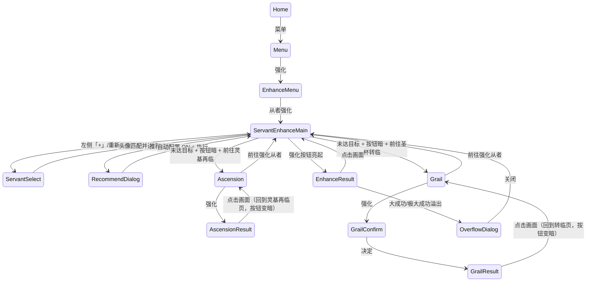
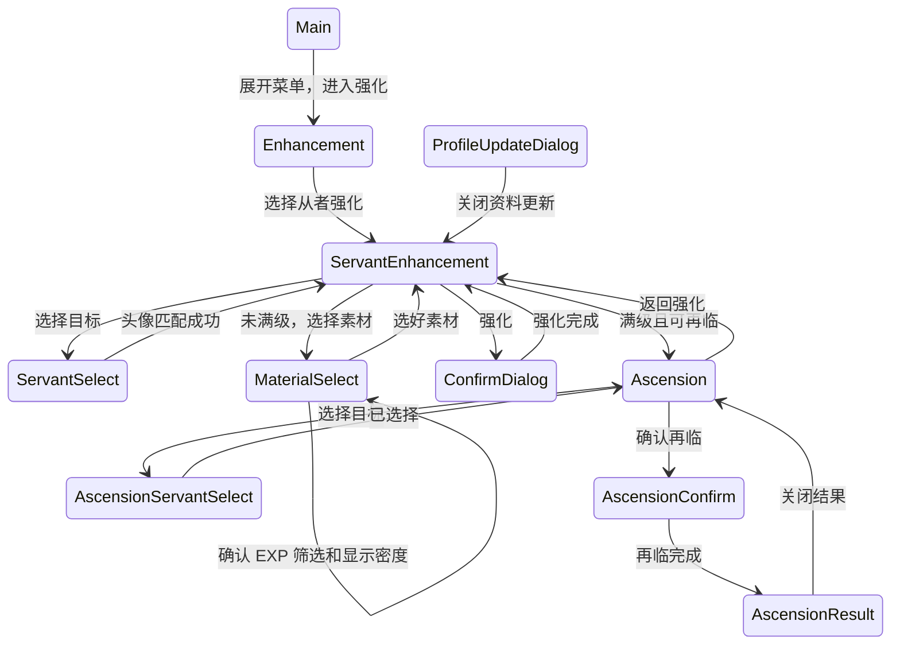

# 从者强化

从者强化有两条独立实现：

- **国服 · 多从者队列**：[servant_enhancement](../../src-tauri/src/servant_enhancement/) 与其命令 [automation/servant_enhancement.rs](../../src-tauri/src/commands/automation/servant_enhancement.rs)。主页「从者强化」卡片进入，后台持久化队列并逐个执行。
- **日服 · 单目标旧流程**：[enhancement_runner.rs](../../src-tauri/src/enhancement_runner.rs) 及其同名目录，命令位于 [automation/enhancement.rs](../../src-tauri/src/commands/automation/enhancement.rs)。

两条流程都遵循[公共生命周期约定](README.md)。

## 国服多从者队列

### 画面流程

主界面、灵基再临、圣杯转临共用右下角「强化」按钮。按钮亮 = 可执行；按钮暗 = 不可执行。主界面先用当前等级判断是否达到用户目标；未达到时，按钮亮则执行，按钮暗且存在「前往灵基再临」/「前往圣杯转临」则进入对应页面，没有入口则尝试一次推荐选择。推荐选择后按钮仍暗才跳过，不推断素材或量子余额。

### 画面识别

国服页面导航依赖 OCR 文本，执行条件读取按钮亮度；当前等级另走专用图像分割与数字识别，不新增 `cv.json` screen：

| 画面 | 判定文本 |
| --- | --- |
| 主页 | `通知` + `菜单` |
| 菜单展开 | `个人空间` / `召唤` |
| 强化菜单 | `从者技能强化` / `概念礼装强化` |
| 从者强化主界面 | `强化用素材` / `请先选择想要强化的从者` |
| 从者选择列表 | `请选择想要强化的从者` / `持有从者` / `等级顺序` |
| 推荐素材选择 | `推荐素材选择` |
| 强化二次确认 | `包含★3以上的素材` / `是否进行强化合成` |
| 强化结果 | `请点击游戏界面` / `已到达等级上限` / `习得新的技能` / `圣肖像进化` |
| 经验溢出提示 | `经验值溢出` / `并未使用` |
| 灵基再临 | `灵基再临结果` / `灵基再临必要道具` |
| 圣杯转临 | `圣杯转临结果` / `圣杯转临所必需` |
| 圣杯转临（转临后） | `尚未达到圣杯转临所需的等级`（红色提示条 + 暗「强化」+「前往强化从者」） |
| 圣杯转临确认 | `是否进行` + `圣杯转临` |

按钮亮度读取右下角 `(0.833, 0.895, 0.035, 0.06)` 区域的平均流明：约 `195` 为亮、`100` 为暗，阈值 `150`。是否可执行只依赖这个亮度，不读取或推算素材、量子、圣杯、从者币数量；画面文字仅用于页面识别和导航。

### 当前等级读取

- 国服队列使用独立的 `read_enhancement_current_level` sidecar 请求。以实际 1920×1080 视频帧中的 `(634, 670, 259, 86)` 为等级区域，按归一化坐标取图后统一到该尺寸。先通过白色连通笔画的细长比例、负斜率与直线残差定位斜杠，再仅裁出它左侧的完整数字；不读取右侧等级上限、材料等级或强化后预览。
- 数字图去掉背景后交给 PP-OCRv6 的纯文字识别接口，跳过全文检测。只接受 1～3 位完整数字、识别位数与图像中的数字数一致、置信度至少 `0.95`，并满足 `1 <= 当前 <= 150`。缺失/多个斜杠、数字不完整或不对齐、低置信度均拒绝；不会将 OCR 的 `371` 直接截成 `37`，也不回退到整屏 `当前/上限` OCR 或日服/战斗数字模板。
- Rust 在相隔至少 `250ms` 的两次独立帧请求中读到相同当前等级后才接受。只用 `当前 >= 目标` 判断完成，不再依赖当前上限，状态中的 `maxLevel` 留空。
- 选择后、每次强化后与动画等待中的等级复查使用同一路径。失败日志包含数字原文和明确的分割/识别失败原因，连续 7 次失败才跳过，并保留队列条目供下次重试。
- [当前等级截图裁剪](../../sidecar/cv-code/tests/test_data/enhancement-level-cn/README.md) 与 [专用读取测试](../../sidecar/cv-code/tests/test_enhancement_level.py) 覆盖真实 `1/40`、`37/40`、`40/40`、`80/80`，以及由真实字形组合的三位数、1920×1080 / 2560×1440、斜杠缺失/歧义、空白及低置信度。Rust 测试覆盖双帧一致性、当前等级目标判断与按钮决策。

### 从者选择与 2EXP

- 队列条目可拖拽排序（运行中禁用拖动与编辑），每个条目带独立启用开关：停用的条目保留在队列里，启动时直接标记为「已禁用（本次跳过）」，不进目标列表。
- 进入列表后先打开「筛选」，按目标的稀有度和职阶过滤（1920×1080 固定布局：稀有度行 y≈0.343，职阶行 y≈0.548，`决定` x≈0.86/y≈0.87），先点「回到初始设定」清空上次勾选，再勾选目标稀有度/职阶，把候选压到一页内，避免依赖不稳定的列表滚动；筛选后网格头像匹配阈值为 `0.60`，普通列表为 `0.85`。筛选未识别成功时回退到滚动列表，筛选请求错误正常上报。
- 列表使用现有 `find_enhancement_servant_grid` 头像匹配。**国服跳过网格锚点检测**（`skipGrid`）：这套「从者强化」选人界面的卡片下半部盖着「等级&强化 / 达到最大」状态条，`text_servant_avatar_bottom_line` 锚线被遮住，实测默认阈值下 `anchors` 恒为 0，网格路径不可能产出结果；因此国服直接对列表区域搜索目标头像裁剪，不再白跑一次约 110 ms 的锚点扫描。日服保持网格路径不变。
- 画面判定优先走模板探针（`probe_template`，~20-40 ms/次）：推荐素材选择标题、圣杯转临确认标题、强化确认标题、溢出提示标题、结果画面的「请点击游戏界面」、从者选择标题、「从者强化」标题、灵基再临标题、圣杯转临标题、强化按钮、从者强化入口、主页「通知」按优先级匹配；未命中才回退整屏 OCR。需要文本的判定（主界面从者名、`前往圣杯转临`/`前往灵基再临`、推荐对话框 `自动配置关`、灵基再临/圣杯转临的提示与结果标题）用 rec-only 文本条批量读取，不再整屏识别。
- 灵基再临/圣杯转临/强化/突破动画期间：探针匹配不到画面且中心区域仍在变化时**不做 OCR**，只按节奏点击跳过对话并短轮询；画面静止后才回退整屏 OCR（用于没有锚点的画面，例如筛选对话框）。动画结束后的结果画面由「请点击游戏界面」锚点直接判定。
- 筛选对话框坐标按国服截图 OCR 标定：稀有度行 y=0.340，职阶三行 y=0.556/0.669/0.781（5 列 x=0.208/0.354/0.500/0.646/0.792），底部「回到初始设定/取消/决定」y=0.887。点击前先点一次对话框滚动条顶端（直接跳回顶部），避免上次会话残留的滚动位置导致点错行。
- 筛选对话框不再整屏 OCR：点击「筛选」后以中心区域亮度变化（±5）判断对话框是否打开，画面几乎不变时才回退整屏 OCR；应用筛选后用画面稳定轮询收尾。
- 关闭对话框与「确认已关闭」合并为一次等待：强化确认、强化结果各自用锚点（对话框标题 / 「请点击游戏界面」）轮询到消失即继续，不再「固定等待 + 再识别一次」。
- 固定等待改为「画面稳定轮询」：每 25 ms 采样中心区域亮度，连续 3 次稳定即继续，超时取旧等待值；因此 250/600/700/1600 ms 这类等待只在画面确实持续变化时才等满。
- 国服直接搜索区域只覆盖卡片网格 `(0.045, 0.22, 0.74, 0.78)`：不含顶部「持有从者 / 筛选 / 等级顺序」标题栏和右侧滚动条/所持栏位面板，同时包含最底部那一行只露出上半部分的卡片。该区域由调试页画面上的搜索框覆盖层标定，Rust 测试固定其边界。
- **直接搜索阈值必须显式传给 sidecar**：`find_enhancement_servant_grid` 的 `directSearchThreshold` 缺省时 sidecar 会把直接搜索阈值抬到 `max(0.85, faceThreshold)`，于是任何更低的阈值（筛选后的 0.60、2EXP 的 0.72）都会被静默覆盖——调试页因为显式传了阈值能命中，实际流程却是 0.85 门槛。Rust 侧统一走 `search_servant_list`，把调用方阈值同时作为 `faceThreshold` 与 `directSearchThreshold` 传入。
- 直接搜索使用当前分辨率对应的模板尺寸（`223 × 帧宽 / 2560`）、指定头像和 2EXP 裁剪；未显式提供直接搜索阈值时沿用至少 `0.85` 的下限，调试页可以下探。搜索采用「半分辨率粗搜 + 全分辨率局部精修」，精修分数落在阈值 ±0.02 内时再对整个区域做一次全分辨率复核，因此命中判定与全分辨率搜索一致。诊断记录 `matchMethod`、`directSearchAttempted`、`directSearchThreshold`、`gridSkipped`、`pyramid` 与阶段耗时（`frameMs` / `gridMs` / `templateMs` / `matchMs` / `directSearchMs` / `totalMs`）；Rust 日志区分网格/直接搜索并带失败原因。
- 国服从者列表有 5 / 6 / 7 列三种显示密度（列数越多卡片越小），而头像模板尺寸按 7 列标定。进入列表后先探针左下角的显示密度按钮（模板 `enhancement_ce/button_scale_level_3`，区域 `(0, 0.89, 0.061, 0.104)`，参考宽度 2560，阈值 0.80）：只有 7 列时该按钮显示 4×4 图标并命中；未命中则点击按钮（最多两次，三种密度两跳必到 7 列），每次点击后重新探针，直到确认 7 列再执行筛选与头像搜索。确认失败时只记警告并按 7 列继续，不阻断队列。
- 离线截图 `tests/test_data/screenshots/servant_select_cn_partial.png` 与独立头像模板覆盖 1920×1080 / 2560×1440、零锚点、底部半行、无目标、指定其他再临头像、列表边界和 2EXP 遮挡。
- 每个条目可指定头像（`face_key`）。指定后只用该头像模板；不指定时才尝试该从者的全部头像。不同再临头像视为不同识别目标，不做跨头像回退。
- `two_exp` 是识别提示：改用卡面**左下角**裁剪（模板区域 `x 0 / y 0.66 / w 0.30 / h 0.34`）以 `0.72` 阈值尝试，再回退 `0.85` 普通匹配。命中/回退都会写日志。
- 2EXP 徽章横向覆盖卡面中部，正好压在默认横带裁剪上；实测截图中目标卡在左下角区域得 `0.971`、次高卡 `0.462`，而旧的横带 + `maskRegion` 只有 `0.19` / `0.27`。因此 2EXP 分支不再传 `maskRegion`，sidecar 的 mask 支持保留给其他调用。
- 左下角区域较小，平坦画面容易出高分，实测全量模板扫描出现过 `1.0000` 的假满分；后续若要下调阈值，需同时加最小方差或邻域一致性约束。

### 素材与突破

- 点击「推荐选择」后，只确保对话框内「自动配置」为开，再点「执行」，不修改种类、稀有度等其他筛选。自动配置会按当前等级上限填入足够素材，而不是固定 20 个。
- 推荐选择相关点击坐标按国服 1920×1080 截图 OCR 标定：主界面「推荐选择」`(0.851, 0.233)`、对话框「执行」`(0.655, 0.876)`、「关闭」`(0.343, 0.876)`、「自动配置开」`(0.625, 0.608)`。旧值会点到「自动配置ON」文字或「初始化 / 解除所有选择」行，导致对话框打不开或被清空。
- 主界面亮 → 点「强化」→ 点击结果画面；技能/宝具升级结果同样点击画面。自动选择的素材含 3★ 以上时，游戏会先弹「包含★3以上的素材！是否进行强化合成？」确认框，点「决定」继续（`wait_for_enhance_result` 内处理）。
- 灵基再临：按钮亮 → 点「强化」；按钮暗且存在返回强化从者的导航提示 → 点「前往强化从者」返回主界面；其他暗状态 → 跳过，原因统一为强化按钮未亮起，不判定缺少哪一种资源。
- 圣杯转临：按钮亮 → 点「强化」→ 确认框点「决定」→ 结果页点击；按钮暗且页面提示尚未满足转临等级时返回强化从者，其他暗状态 → 跳过。不计算资源数量，循环检查当前等级是否达到目标。
- 圣杯转临成功后游戏不留在结果页：等级上限 +2 而从者等级未变，于是回到「圣杯转临」页，顶部红色提示 `尚未达到圣杯转临所需的等级`、右下「强化」变暗，并提供「前往强化从者」`(0.82, 0.40)`。等待动画的判定要接受这一页，随后点「前往强化从者」回到从者强化主界面继续升级；否则会一直点结果页的「请点击游戏界面」位置 `(0.50, 0.95)`，直到 `75s` 超时并把整个队列判为失败。
- 动画等待共用的顶部提示条为 `(0.29, 0.145, 0.33, 0.068)`，按最长文案 `尚未达到圣杯转临所需的等级`（14 字，实测 x 0.310..0.570 / y 0.167..0.208）定宽。旧的 0.25 宽裁剪切掉了末尾「级」，14 字短语永远匹配不上，是圣杯转临后卡在底部连点的根因。
- 圣杯等待除文案外还有一条不依赖 OCR 的收尾条件：确认框（`是否进行「圣杯转临」？`）出现过、画面稳定、且右下「强化」为暗，即认定已回到转临后页面并结束等待；确认框出现之前的亮按钮页面与动画中间帧都不算完成，避免提前退出。
- 灵基再临 / 圣杯转临的长对话动画期间轮询等待，单段最长等待 `75s`。周期性点击使用**画面正下方** `(0.50, 0.95)`，不要点屏幕中央，否则从者强化的素材槽可能被误触并打开素材选择界面；等待期间同时处理圣杯确认框和经验溢出提示。

### 队列与命令

- 队列文件：`app_data_dir()/servant_enhancement_queue.json`，条目包含稳定 `id`、`variantKey`、目标等级、`twoExp`、`faceKey`、`enabled`（缺省 true）。整份队列通过 `save_servant_enhancement_queue` 一次性保存，拖拽排序与启用开关都走这条路径。
- 命令：`get_servant_enhancement_queue`、`save_servant_enhancement_queue`、`start_servant_enhancement_automation`、`stop_servant_enhancement_automation`、`get_servant_enhancement_automation_status`、`list_servant_faces`。
- 事件：`servant-enhancement-automation-status`，携带 `status`、当前画面、全部条目状态、当前条目 id 与等级。
- 完成（达到目标等级）后从队列移除并进入「本次完成」；跳过/失败保留，下次运行自动重试。运行中锁定队列编辑与拖拽；停用条目不会被加载为执行目标，全部停用时启动直接报「从者强化队列中没有启用的从者」。仅国服可启动，其他服务器显示警告并禁用开始。
- 整个队列正常结束后，从强化页逐级返回（返回强化菜单 → 关闭），把游戏留在主页；中途手动停止则保留当前画面。选择/强化期间取消统一将当前条目还原为待处理并清空当前条目标识，立即退出队列，不记为跳过，也不发「处理完成」。点击与滑动前检查取消标记。
- 选择失败区分列表滑动上限、页面导航上限和连续未知画面上限；日志显示实际已完成的滑动次数，不再将任意退出都写成「已重试 60 次」。识别到已知画面后清零连续未知计数，最多执行 60 次列表滑动，最后一次滑动后仍可匹配成功。
- 队列页测试位于 [src/features/enhancement/__tests__/EnhancementPage.test.tsx](../../src/features/enhancement/__tests__/EnhancementPage.test.tsx)，Rust 纯逻辑测试位于 [servant_enhancement/tests.rs](../../src-tauri/src/servant_enhancement/tests.rs)。

## 日服单目标流程

### 画面流程

选择页是所属 screen 的 variant；确认框和结果页部分依赖 OCR。

### 识别与模板

先匹配 screen anchor，再识别 variant，最后通过 element 判断菜单、筛选框和可执行状态。配置见 [JP cv.json](../../src-tauri/resources/servers/jp/cv.json)，默认 screen 阈值为 `0.85`，variant / element 阈值为 `0.80`。

| Screen | Anchor |
| --- | --- |
| `Main` | `button_notification` |
| `Enhancement` | `text_enhancement` |
| `ServantEnhancement` | `text_enhancement_servant` |
| `Ascension` | `screen_enhancement_ascension` |

| 视图 / 状态 | 模板或元素 |
| --- | --- |
| 主菜单展开 / 收起 | `button_enhancement` / `button_menu` |
| 从者强化主视图 | `text_enhancement_result` |
| 从者选择 | `text_enhancement_servant_select` |
| 素材选择 | `text_enhancement_material` |
| 素材筛选框 | `dialog_filter_setting` |
| 再临主视图 / 从者选择 | `text_ascension_main_variant` / `text_enhancement_ascension_servant_select` |
| 再临不可执行 | `enhancement_ascension_not_ready` |
| 最大列表密度 | `button_scale_level_3` |

国服不配置这些从者强化专用画面；国服礼装强化使用独立的 `CraftEssenceEnhancement` 配置。

### 执行条件

- 从者列表先确认最大显示密度；未命中时最多切换 3 次，再通过头像匹配目标。
- 素材页用 OCR 确认仅筛选 EXP 素材，确认显示密度后选择 20 个素材。`text_filter_setting_type` 只证明筛选标签存在，不能证明 EXP 选项已启用。
- 等级达到上限后，仅检查再临入口；再临处于 `NotReady` 时停止，报告素材不足或状态不可执行。
- 对话框 OCR 限定在中部文字区；等级和素材计数分别读取对应的小区域。

### OCR 与兼容路径

等级、已选素材数量、二次确认、资料更新和再临结果仍依赖 OCR 或既有坐标恢复。结果返回时优先使用 `button_enhancement_ascension_to_servant`。

替换这些路径需要可唯一识别确认框、资料更新、再临结果、素材数量和 EXP 三态筛选的模板；不要用单个标签命中代替完整状态校验。现有兼容路径见 [Fallback 注册表](../fallbacks.md)。

生命周期与流程测试位于 [enhancement_runner/tests.rs](../../src-tauri/src/enhancement_runner/tests.rs)，识别回归位于 [sidecar tests](../../sidecar/cv-code/tests/)。
